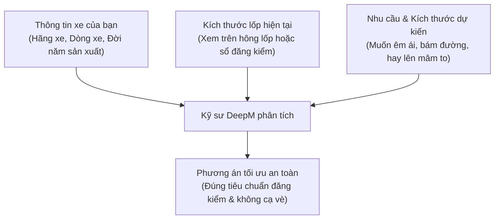

# 9. Hướng Dẫn Liên Hệ Tư Vấn & Hỗ Trợ Kỹ Thuật

Nếu bạn có bất kỳ thắc mắc nào về thông số lốp xe, phương án lên mâm an toàn, hoặc cần tư vấn dòng lốp phù hợp nhất với điều kiện đường sá và ngân sách của mình, đội ngũ kỹ thuật viên của **DeepM Lab** luôn sẵn sàng đồng hành hỗ trợ bạn.

---

## 🛠️ Các kênh hỗ trợ khách hàng chính thức

* **Cổng công cụ trực tuyến**: [DeepM Toolbox Engineering](https://deepm.vn/giai-ma-lop-xe)
* **Website thương hiệu**: [DeepM.vn](https://deepm.vn)
* **Khu vực phản hồi trực tiếp**: Cuộn xuống chân trang của bất kỳ công cụ nào tại mục **"Tư vấn & Hỗ trợ kỹ thuật"**.
* **Hotline hỗ trợ kỹ thuật**: Liên hệ trực tiếp số hotline hiển thị tại phần chân trang ứng dụng để được giải đáp khẩn cấp về an toàn lốp xe.

---

## 📝 Quy trình gửi yêu cầu tư vấn kích thước lốp

Để nhận được tư vấn chuẩn xác nhất từ các kỹ sư DeepM, bạn nên chuẩn bị trước các thông tin sau khi liên hệ:

1. **Thông tin xe**: Ví dụ: *Honda CR-V đời 2022 bản L*.
2. **Kích thước lốp nguyên bản (Zin)**: Ví dụ: *235/60R18*.
3. **Mục đích nâng cấp**:
   * Cần tìm dòng lốp đi êm hơn, giảm tiếng ồn dội từ hốc bánh.
   * Hoặc muốn độ mâm lên 19 inch / 20 inch cho thể thao.
   * Hoặc xe bán tải muốn lắp lốp gai A/T đi phượt và công trường.
4. **Hình ảnh thực tế**: Bạn có thể chụp ảnh mã thông số trên hông lốp và khoảng hở hốc bánh xe hiện tại để gửi cho kỹ thuật viên đánh giá độ hở an toàn.

---

## ⏱️ Thời gian phản hồi

* Đội ngũ kỹ thuật viên DeepM tiếp nhận và phản hồi các yêu cầu tư vấn kỹ thuật trong vòng **15 - 30 phút** trong giờ làm việc hành chính.
* Các công cụ tính toán tự động trên [DeepM Toolbox](https://deepm.vn/tho-may) luôn sẵn sàng phục vụ bạn **24/7 hoàn toàn miễn phí**.
