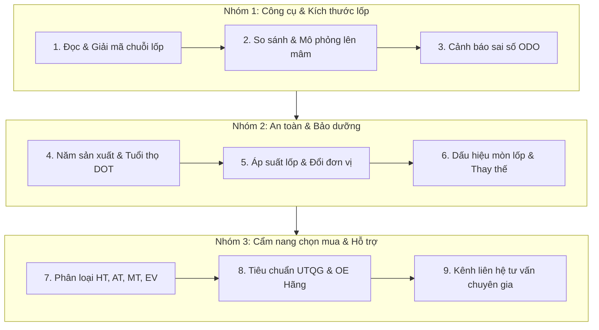

# Cổng Hướng Dẫn Dành Cho Khách Hàng & Chủ Xe

Chào mừng bạn đến với khu vực tài liệu dành riêng cho **Chủ sở hữu xe hơi và Khách hàng cá nhân**. Tại đây, bạn sẽ được trang bị đầy đủ kiến thức và hướng dẫn từng bước để sử dụng bộ công cụ **DeepM Lab** nhằm lựa chọn lốp xe an toàn, chuẩn xác và đúng quy định kỹ thuật.

---

## 🎯 Mục tiêu khu vực này giúp bạn

1. **Hiểu rõ ý nghĩa mọi con số trên lốp xe của mình**: Không còn bỡ ngỡ trước các dãy số phức tạp như `205/55R16 91V`, `DOT 4522`, `Treadwear 340` hay các ký hiệu cho xe tải/bán tải.
2. **Kiểm tra an toàn trước khi thay lốp hoặc lên mâm**: Nhìn thấy tận mắt sự thay đổi về kích thước, khoảng sáng gầm xe và độ rộng tiếp xúc mặt đường thông qua công cụ mô phỏng trực quan 2D.
3. **Phòng tránh phạt nguội vi phạm tốc độ**: Hiểu rõ xe đang chạy nhanh hơn hay chậm hơn so với kim đồng hồ tốc độ (ODO) khi chuyển sang cỡ lốp khác.

---

## 🧭 Bản đồ tra cứu & Làm chủ bộ công cụ DeepM

### Danh mục hướng dẫn chi tiết:

#### 📐 Phần 1: Công cụ tính toán & Mô phỏng kích thước
* **[1. Đọc & Giải mã thông số lốp xe](/customer/reading-tire-specs)**: Cách sử dụng công cụ bóc tách tự động thông minh của DeepM Lab.
* **[2. So sánh & Mô phỏng lên mâm (Visualizer)](/customer/tire-comparison-visualizer)**: Đặt 2 lốp đè lên nhau để so sánh kích thước thực tế, độ nâng hạ gầm xe.
* **[3. Cảnh báo sai số đồng hồ tốc độ](/customer/speedometer-error)**: Bảng đối chiếu tốc độ thực tế (GPS) và khuyến cáo an toàn tiêu chuẩn **±3%**.

#### 🛡️ Phần 2: Kiểm tra an toàn & Bảo dưỡng lốp
* **[4. Tra cứu tuần/năm sản xuất (Mã DOT) & Tuổi thọ lốp](/customer/dot-date-age)**: Giải mã hạn sử dụng cao su, tránh mua lốp tồn kho date sâu và nguy cơ nổ lốp.
* **[5. Hướng dẫn áp suất lốp & Quy đổi đơn vị (PSI, Bar, kPa)](/customer/tire-pressure-guide)**: Phân biệt áp suất khuyến nghị xe và áp suất tối đa, bảng quy đổi áp suất.
* **[6. Nhận biết dấu hiệu mòn lốp & Thời điểm cần thay](/customer/tire-wear-inspection)**: Vạch chỉ báo TWI 1.6mm và 6 dạng mòn lốp bất thường phản ánh bệnh thước lái.

#### 🚘 Phần 3: Cẩm nang chọn mua lốp & Hỗ trợ kỹ thuật
* **[7. Phân loại các dòng lốp: HT, AT, MT, RT, EV & Run-Flat](/customer/tire-terrain-types)**: Lựa chọn đúng dòng lốp theo cung đường, xe xăng vs xe điện (EV).
* **[8. Tiêu chuẩn UTQG & Ký hiệu lốp hãng xe (OE Markings)](/customer/utqg-oe-markings)**: Bộ 3 chỉ số Treadwear, Traction, Temperature và dấu hiệu lốp theo xe sang (★, MO, AO, N0...).
* **[9. Hướng dẫn liên hệ tư vấn & Hỗ trợ kỹ thuật](/customer/contact-support)**: Kết nối trực tiếp với chuyên gia kỹ thuật của DeepM.

---

::: tip 🔗 Truy cập nhanh công cụ
Bạn có thể mở ngay công cụ giải mã lốp xe trực tuyến tại [DeepM Toolbox Engineering](https://deepm.vn/giai-ma-lop-xe) để vừa đọc hướng dẫn vừa thực hành song song.
:::
