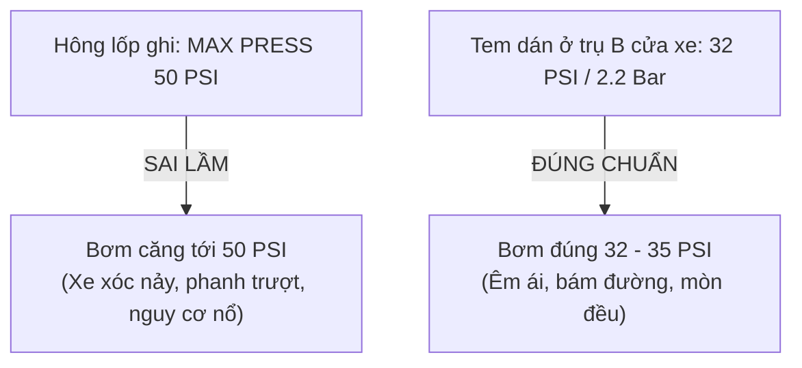

# 5. Hướng Dẫn Áp Suất Lốp & Quy Đổi Đơn Vị (PSI, Bar, kPa)

Áp suất lốp là yếu tố sống còn ảnh hưởng trực tiếp đến **an toàn tính mạng, độ êm ái, quãng đường phanh và mức tiêu hao nhiên liệu**. Tuy nhiên, rất nhiều chủ xe nhầm lẫn giữa **Áp suất tiêu chuẩn của xe** và **Áp suất tối đa ghi trên lốp**.

---

## ⚠️ Phân biệt Áp suất khuyên dùng vs Áp suất tối đa (Max Press)

Một trong những sai lầm phổ biến nhất của người dùng là bơm lốp theo con số ghi trên hông lốp:

* **Áp suất tối đa (MAX PRESS - dập nổi trên hông lốp)**:
  * Ví dụ: `MAX PRESS 44 PSI (300 kPa)` hoặc `MAX PRESS 50 PSI`.
  * Đây là **ngưỡng giới hạn chịu áp suất cao nhất** của cấu trúc lốp để nhà sản xuất đảm bảo lốp không bị bung tanh. **Tuyệt đối không bơm xe hằng ngày ở mức này!**
* **Áp suất khuyến nghị của xe (Placard - dán tại trụ B hoặc nắp bình xăng)**:
  * Đây mới là con số bạn cần tuân theo! Các kỹ sư của hãng xe đã tính toán tối ưu dựa trên trọng lượng khung gầm, tải trọng và hệ thống treo của chiếc xe bạn đang lái (thường dao động từ **30 đến 36 PSI**, tức **2.1 - 2.5 Bar**).

---

## 🔄 Bảng quy đổi nhanh giữa các đơn vị áp suất

<TirePressureConverter />

Tại Việt Nam, đồng hồ bơm lốp tại các garage hoặc máy bơm mini thường dùng nhiều đơn vị khác nhau:

| Đơn vị | Ký hiệu | Tỷ lệ quy đổi tương đương | Ứng dụng phổ biến |
| :--- | :--- | :--- | :--- |
| **Pound per Square Inch** | **PSI** | 1 Bar ≈ 14.504 PSI | Bơm lốp xe con, xe bán tải, máy bơm cầm tay |
| **Bar** | **bar** | 1 Bar = 100 kPa ≈ 1.02 kg/cm² | Xe châu Âu (Mercedes, BMW, Audi, Porsche...) |
| **Kilopascal** | **kPa** | 100 kPa = 1 Bar ≈ 14.5 PSI | Bảng thông số kỹ thuật xe Nhật (Toyota, Lexus...) |
| **Kg trên centimet vuông** | **kg/cm²** | 1 kg/cm² ≈ 0.98 Bar ≈ 14.22 PSI | Thợ máy quen gọi là "2 cân", "2 cân rưỡi" |

### Bảng tra cứu đối chiếu thực tế:

| Khuyến nghị (Bar) | PSI tương đương | kPa tương đương | Số "cân" thợ Việt Nam hay gọi |
| :---: | :---: | :---: | :---: |
| **2.1 bar** | **30.5 PSI** | 210 kPa | ~ 2.1 kg/cm² |
| **2.2 bar** | **32.0 PSI** | 220 kPa | ~ 2.2 kg/cm² |
| **2.3 bar** | **33.4 PSI** | 230 kPa | ~ 2.3 kg/cm² |
| **2.4 bar** | **34.8 PSI** | 240 kPa | ~ 2.4 kg/cm² |
| **2.5 bar** | **36.3 PSI** | 250 kPa | ~ 2.5 kg/cm² |

---

## 🌡️ Nguyên tắc vàng khi kiểm tra & bơm áp suất lốp

1. **Đo áp suất khi lốp nguội (Cold Tire Pressure)**:
   * Đo vào buổi sáng trước khi lăn bánh hoặc sau khi xe đã đỗ yên tĩnh ít nhất 3 giờ.
   * Khi xe chạy tốc độ cao trên đường, ma sát sinh nhiệt sẽ khiến áp suất trong lốp tự tăng thêm từ **3 đến 5 PSI**. Đừng xả bớt khí khi lốp đang nóng!
2. **Bơm bù khi chở đủ tải hoặc đi xa trên cao tốc**:
   * Nếu chuẩn bị đi xa, chở đủ 5 - 7 người và đầy cốp hành lý, hãy tăng thêm khoảng **2 - 3 PSI** so với mức tiêu chuẩn hằng ngày (kiểm tra hướng dẫn chi tiết theo số lượng hành khách trên tem trụ B xe).
3. **Trang bị cảm biến áp suất lốp (TPMS)**:
   * Giúp bạn phát hiện ngay khi lốp bị đinh cán xì hơi từ từ hoặc nhiệt độ lốp tăng cao bất thường để xử lý kịp thời trước khi rách hông lốp.
