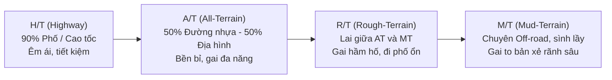

# 7. Phân Loại Dòng Lốp: HT, AT, MT, RT, EV & Run-Flat

Khi chọn mua lốp xe, nhiều chủ xe thường chỉ để ý kích cỡ mà không biết rằng mỗi dòng lốp được thiết kế riêng biệt cho từng loại địa hình, phong cách lái và kiểu động cơ (xe xăng truyền thống vs xe điện hiện đại). Chọn sai dòng lốp sẽ khiến xe **ồn ào, hao xăng, nhanh mòn hoặc giảm độ bám đường**.

---

## 🚙 Các dòng lốp theo địa hình vận hành

### 1. Lốp H/T (Highway Terrain) - Dành cho đường nhựa & đô thị
* **Đặc điểm**: Bề mặt gai mịn, nhiều rãnh thoát nước dọc song song, khối gai cao su mềm êm.
* **Tỷ lệ khuyến nghị**: **90% đường nhựa / 10% đường đất nhẹ**.
* **Ưu điểm**: Cực kỳ êm ái, cách âm khoang lái tốt, cản lăn thấp giúp tiết kiệm nhiên liệu tối đa, bám đường ướt xuất sắc ở tốc độ cao.
* **Nhược điểm**: Rất dễ trượt bánh và dính bùn nếu đi vào đường lầy lội, thành lốp mềm dễ rách khi cạ đá nhọn.
* **Phù hợp cho**: Sedan, Hatchback, Crossover đô thị (CX-5, Tucson, CR-V, SantaFe...) chạy phố và cao tốc.

### 2. Lốp A/T (All Terrain) - Dành cho đa địa hình hỗn hợp
* **Đặc điểm**: Khối gai to hơn, rãnh gai sâu và rộng hơn dòng HT, thành lốp gia cố thêm lớp bố thép chống đâm thủng.
* **Tỷ lệ khuyến nghị**: **50% đường nhựa / 50% đường xấu, đèo dốc, cát sỏi**.
* **Ưu điểm**: Cân bằng hoàn hảo giữa khả năng chạy phố hằng ngày và vượt địa hình sỏi đá, độ bền cao.
* **Nhược điểm**: Ồn hơn lốp HT từ 2 - 4 dB, tiêu hao nhiên liệu tăng nhẹ (khoảng 3 - 5%).
* **Phù hợp cho**: Bán tải (Ranger, Hilux, Triton) và SUV khung gầm rời (Everest, Fortuner, Pajero Sport...).

### 3. Lốp M/T (Mud Terrain) - Chuyên trị bùn lầy & đá hộc
* **Đặc điểm**: Khối gai khổng lồ, rãnh gai cực sâu dạng vấu quắp để bốc bùn và cắn đá, gai tràn cả sang vai lốp.
* **Tỷ lệ khuyến nghị**: **80% - 90% đường Off-road cực đoan**.
* **Ưu điểm**: Khả năng thoát lầy, bám đất mềm và chịu va đập trước đá tảng vô địch.
* **Nhược điểm**: Rất ồn và rần xe khi chạy trên đường nhựa phẳng, khoảng cách phanh đường ướt dài hơn, nhanh mòn nếu đi tốc độ cao.
* **Phù hợp cho**: Dân chơi Off-road chuyên nghiệp, xe đi công trường hầm mỏ, rừng núi hiểm trở.

### 4. Lốp R/T (Rough Terrain) - Dòng lai thời thượng
* **Đặc điểm**: Sự kết hợp hoàn hảo giữa độ hầm hố của gai M/T và sự êm ái của khung lốp A/T.
* **Ưu điểm**: Ngoại hình cực ngầu, bám đường tốt hơn A/T khi off-road nhưng chạy cao tốc lại đỡ ồn hơn M/T rất nhiều.

---

## ⚡ Lốp chuyên dụng cho Xe điện (EV Tires)

Xe ô tô điện (EV) có những đặc tính kỹ thuật rất khác biệt so với xe xăng dầu truyền thống:

1. **Khối lượng pin rất nặng**: Xe điện thường nặng hơn xe xăng cùng kích cỡ từ 300 - 500 kg. Lốp xe điện bắt buộc phải có ký hiệu tải trọng tăng cường **XL (Extra Load)** hoặc **HL (High Load Capacity)**.
2. **Mô-men xoắn tức thời cực mạnh**: Xe điện tăng tốc giật cục từ dải tua máy 0 vòng/phút, dễ gây trượt quay bánh và làm gai lốp mòn nhanh gấp 1.5 - 2 lần so với xe xăng nếu dùng lốp thông thường.
3. **Động cơ điện quá yên tĩnh**: Do không có tiếng nổ máy che lấp, tiếng lốp ma sát dội vào cabin xe điện trở nên rất rõ. Lốp EV chuyên dụng được tích hợp **lớp mút xốp tiêu âm công nghệ cao (Acoustic Foam)** dán mặt trong lòng lốp giúp triệt tiêu tiếng vang rỗng.

---

## 🛡️ Lốp chống xịt (Run-Flat Tires)

* **Ký hiệu nhận biết**: `RFT`, `SSR`, `ROF`, `ZP` (Michelin Zero Pressure), hoặc `RunFlat`.
* **Cách thức hoạt động**: Thành hông lốp được gia cố bằng cao su chịu lực siêu cứng. Khi lốp bị cán đinh xì hết hơi (0 PSI), thành lốp vẫn đứng vững đỡ toàn bộ trọng lượng xe.
* **Lợi ích**: Bạn vẫn có thể tiếp tục lái xe thêm một quãng đường khoảng **80 km** với vận tốc tối đa **80 km/h** để tìm đến garage an toàn mà không phải kích xe thay bánh phụ nguy hiểm giữa đường cao tốc.
* **Lưu ý**: Lốp Run-flat cứng hơn lốp thường, cho cảm giác lái xóc hơn và giá thành thay thế đắt hơn.
