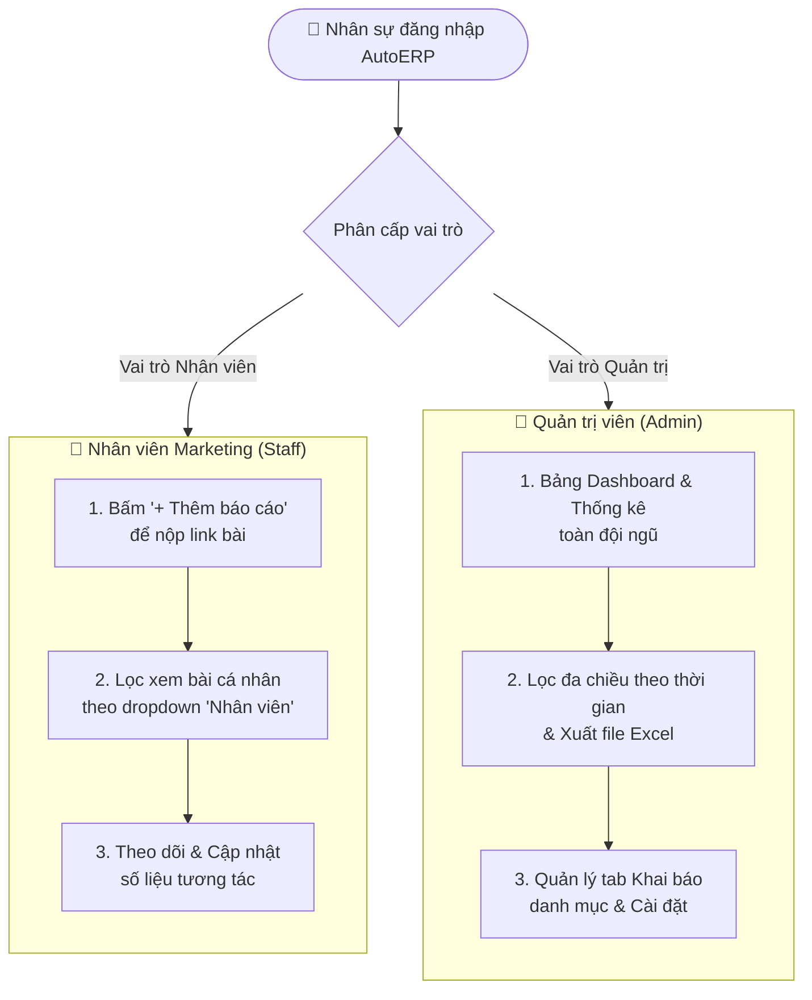

# Cổng Quản Trị & Đội Ngũ Marketing

Khu vực này dành riêng cho **Nhân sự Marketing, Content Creator và Quản trị viên hệ thống (Admin)** sử dụng phân hệ **Marketing Tracker** trên nền tảng **DeepM AutoERP** (`https://deepm.autoerp.vn`). 

Hệ thống được xây dựng nhằm chuẩn hóa việc ghi nhận tiến độ phân phối nội dung, đánh giá độ phủ sóng trên các kênh mạng xã hội và quản lý báo cáo tập trung.

---

## 👥 Hai phân quyền người dùng trong hệ thống

### 1. Nhân viên Marketing (`staff`):
* Bấm nút **"+ Thêm báo cáo"** để nộp link bài đăng ngay sau khi xuất bản trên các nền tảng (Facebook, TikTok, Shorts, Instagram, YouTube, Blog...).
* Theo dõi danh sách bài cá nhân đã nộp bằng cách chọn tên mình tại bộ lọc **Nhân viên**.
* Cập nhật số liệu tương tác (Likes, Comments, Shares, Views) sau các mốc thời gian 24h, 3 ngày, 7 ngày.

### 2. Quản trị viên (`admin`):
* **Tài khoản quản trị viên**: Đăng nhập bằng tài khoản Quản trị viên (Admin) được phân quyền trong hệ thống.
* Xem bảng điều khiển tổng hợp toàn bộ bài viết của tất cả nhân sự với 5 thẻ chỉ số trực quan.
* Lọc báo cáo theo khoảng thời gian tùy chọn (Hôm nay, Tuần này, Tháng này, Quý này...).
* Xuất file Excel báo cáo tổng thể chỉ với một cú nhấp chuột.
* Khai báo danh mục kênh đăng, chiến dịch, định dạng nội dung mới và quản lý cấu hình hệ thống.

---

## 🧭 Các bài viết hướng dẫn chi tiết

* **[1. Khai báo & Nộp báo cáo bài đăng](/marketing/submit-post)**: Cách điền biểu mẫu nộp bài chuẩn chỉnh qua popup modal.
* **[2. Danh sách bài đăng & Báo cáo tương tác](/marketing/tracking-posts)**: Quản lý danh sách bài đăng, lọc theo nhân viên và theo dõi số liệu tương tác.
* **[3. Hướng dẫn dành cho Quản trị viên (Admin Guide)](/marketing/admin-guide)**: Quy trình xem thống kê, lọc dữ liệu, xuất Excel và cấu hình khai báo.

---

::: tip 🔗 Đăng nhập hệ thống Marketing Tracker
Truy cập phân hệ Báo cáo Marketing tại [DeepM AutoERP Marketing Report](https://deepm.autoerp.vn/marketing_report/listing/) để bắt đầu phiên làm việc.
:::
