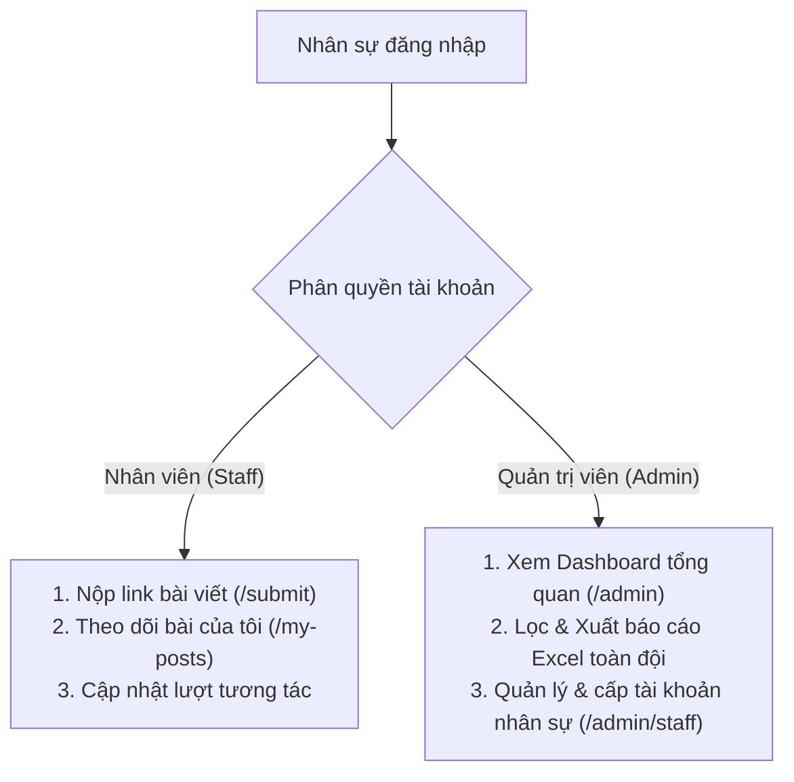

# Cổng Quản Trị & Đội Ngũ Marketing

Khu vực này dành riêng cho **Nhân sự Marketing, Content Creator và Quản trị viên hệ thống (Admin)** sử dụng ứng dụng **DeepM Marketing Tracker**. 

Hệ thống được xây dựng nhằm chuẩn hóa việc ghi nhận tiến độ phân phối nội dung, đánh giá độ phủ sóng trên các kênh mạng xã hội và quản lý nhân sự tập trung.

---

## 👥 Hai phân quyền người dùng trong hệ thống

### 1. Nhân viên Marketing (`staff`):
* Nộp báo cáo link bài đăng ngay sau khi xuất bản trên các nền tảng (Facebook, TikTok, Shorts, Instagram, YouTube, Blog...).
* Theo dõi danh sách bài cá nhân đã nộp tại trang `/my-posts`.
* Cập nhật số liệu tương tác (Likes, Comments, Shares, Views) sau các mốc thời gian 24h, 3 ngày, 7 ngày.

### 2. Quản trị viên (`admin`):
* Tài khoản quản trị chính thức: vuonghongky26@gmail.com.
* Xem bảng điều khiển tổng hợp toàn bộ bài viết của tất cả nhân sự.
* Lọc báo cáo theo khoảng thời gian tùy chọn (Hôm nay, Tuần này, Tháng này, Quý này...).
* Xuất file Excel báo cáo tổng thể.
* Thêm mới nhân viên, cấp tài khoản, đổi quyền (`staff` ↔ `admin`) hoặc vô hiệu hóa tài khoản khi nhân viên nghỉ việc.

---

## 🧭 Các bài viết hướng dẫn chi tiết

* **[1. Hướng dẫn nộp link bài truyền thông](/marketing/submit-post)**: Cách điền biểu mẫu nộp bài chuẩn chỉnh.
* **[2. Theo dõi bài viết của tôi (/my-posts)](/marketing/tracking-posts)**: Quản lý và cập nhật số liệu bài viết cá nhân.
* **[3. Hướng dẫn dành cho Quản trị viên (Admin Guide)](/marketing/admin-guide)**: Quy trình duyệt báo cáo, lọc dữ liệu và quản trị nhân sự tại `/admin/staff`.

---

::: tip 🔗 Đăng nhập hệ thống Marketing Tracker
Truy cập trang đăng nhập tại [DeepM Marketing Tracker](https://marketing-tracker-navy.vercel.app/) để bắt đầu phiên làm việc.
:::
